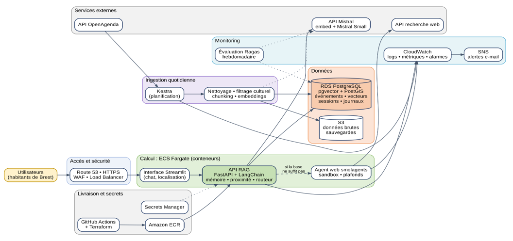
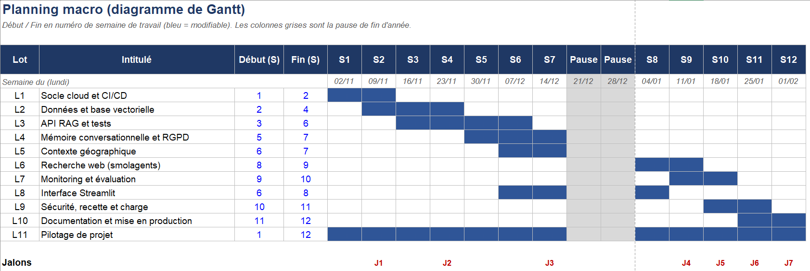

🇬🇧 English | readme en français 👉 [🇫🇷 Français](README.md)

# From POC to MVP: Design Study and Project Management (Puls-Events)

This repository contains the project management work I did to take an AI chatbot from the **POC** stage (a demo that proves the idea works) to the **MVP** stage (a first version that real users can use, hosted in the cloud).

Important: here, **nothing is coded**. This is a **design study**: we plan, we estimate costs, we anticipate risks and we draw the architecture before building anything. This is exactly what the mission asked for.

---

## The context in a few words

In a previous project, I built a **POC**: an assistant that recommends events in Brest using OpenAgenda data, without making up answers (RAG architecture).

The POC was a success. My technical manager therefore asked me to prepare the next step: a solid MVP that can handle growth.

## What was asked:

Four improvements to include in the design:

| Improvement | In plain words |
|---|---|
| **Conversational memory** | The assistant remembers the last exchanges ("and is it free?") |
| **Geographic context** | It suggests events close to the user |
| **Real-time web search** | It searches the web for recent information with smolagents (Hugging Face) when its own database is not enough |
| **Monitoring** | We know if the service is reliable, up to date and affordable |

And a project management report that covers: needs, project plan, backlog, cloud architecture, costs (build and running), and a final review.

## What this repository contains

| File | What it is for |
|---|---|
| `docs/rapport_gestion_projet.pdf` | **The full report** (follows the template provided). This is the main document. |
| `docs/support_presentation.pptx` | The slides used for the oral defense |
| `docs/backlog_couts_planning.xlsx` | The Excel workbook: backlog, risks, milestones, planning, costs, assumptions (editable, everything recalculates) |
| `docs/schema_architecture_MVP.png` | The cloud architecture diagram |
| `docs/gantt_planning_MVP.png` | The planning as a Gantt chart |

---

## The study in summary

### 1. Needs and users
Four profiles: the Brest resident who wants a quick outing, the family, the visitor who does not know the city, and the Puls-Events team who follows quality and costs. For each one, concrete example questions ("an exhibition less than 2 km from Recouvrance", "and is it free?", "is tonight's concert still on?").

### 2. The project plan
- **12 weeks of work**, from 2 November 2026 to 5 February 2027, with a break at Christmas
- **8 milestones (J0 to J7)**, each with a demo and an acceptance criterion:
  study validation (J0, 30 October), cloud foundation, data and vector database, API with memory and geography (J3, 18 December), web agent and interface, monitoring, acceptance testing, go-live (J7, 5 February)
- 2-week cycles and a risk register reviewed every week

### 3. The macro backlog
**28 features**, ranked with a simplified MoSCoW method:
- **19 Must-Have**: essential for the MVP, about 82 days of work
- **9 Nice-to-Have**: useful but can wait (user accounts for example), about 40 days, estimated separately

Each line has a priority, an estimate in days, a level of technical uncertainty and a milestone.

A small clarification, because it can be confusing: the 82 days are the **total workload** of several people (Data Engineer, part-time developer, DevOps support) working in parallel. That is why it fits in 12 weeks. Without extra help, it would take about 16 weeks.

### 4. Risks
**11 risks** are tracked, each with a way to reduce it. The four most serious ones:
- **The web agent** runs code and can return wrong information: isolated container, limited tools, capped steps and duration, a "web source" label, used only as a fallback
- **Personal data (GDPR)**: no accounts, anonymous sessions, deletion after 30 days, consent before geolocation
- **Data quality**: cultural filtering and deduplication
- **Resources**: confirm the extra help as early as the kick-off

### 5. The cloud architecture
Hosted on **AWS, Paris region**, using containers:

| Component | Role |
|---|---|
| ECS Fargate | Runs the API, the interface and the web agent (isolated) without managing servers |
| PostgreSQL (RDS) with **pgvector** and **PostGIS** | One single database for vectors (search by meaning), coordinates (search by distance), sessions and logs |
| Kestra | Daily collection of events from OpenAgenda |
| Terraform + GitHub Actions | Infrastructure described as code, automatic tests and deployment |
| Secrets Manager | Keys are never in the code |
| CloudWatch + SNS + Ragas | Technical monitoring, alerts and weekly evaluation of answer quality |

Three key words from the brief: **deployment** (3 environments, automatic rollback), **modularity** (4 independent services, we can change the model or the database without rewriting everything) and **monitoring** (technical, AI quality, data freshness, costs).

### 6. Why AWS?
I based my choice on a technology watch: AWS holds about 28% of the cloud market in the second quarter of 2026, ahead of Azure (20%) and Google Cloud (15%). But all three can do everything. So I decided on two criteria: **the team's experience** (I have already deployed a project on AWS) and **the largest ecosystem**. For the vector database, I compared FAISS, PostgreSQL with pgvector and Amazon S3 Vectors: PostgreSQL wins because it puts everything in the same place, and S3 Vectors stays as an exit option if the volume explodes.

### 7. Costs

**Build**: about **€57,200**, which is 102 days of work (€49,170), 15% for unexpected issues, a little cloud for testing and some tools.

**Running costs (OPEX)** depending on the number of users:

| Scenario | Users | Cost per month | Cost per user |
|---|---|---|---|
| Pilot | 1,000 | about €239 | €0.24 |
| Growth | 10,000 | about €428 | €0.04 |
| Scale | 50,000 | about €1,120 | €0.02 |

The total cost goes up with usage, but the cost **per user goes down**: a large part of the infrastructure is fixed and is shared between more people.

### 8. Optimizations
7 levers on the Growth scenario (web search cache, answer cache, removing a network component that is billed all the time, cheaper processors, Spot machines for the web agent, a lighter scheduler, a reserved database). With a safety factor of 0.8: **about €428 down to €315 per month, which is roughly 26% savings**.

### 9. Review: challenges and solutions

| Challenge | Solution |
|---|---|
| API key written directly in a script | Key regenerated, `.env` file, then Secrets Manager in the MVP |
| Poor search results (an event's header was separated from its description) | Header repeated in every chunk |
| The same event returned several times | Deduplication by identifier |
| 73% of the data were job offers | Cultural filtering, which became a Must-Have feature |

### Decisions asked from the technical manager
1. Validate the Must-Have scope (web agent as a fallback only)
2. Confirm a part-time developer and DevOps support
3. Validate AWS Paris with a single PostgreSQL database
4. Allow me to ask for quotes (web search) and refine the costing with the AWS calculator

---

## Where to start?

1. Read **sections 1 and 7 (introduction and review)** of the report to understand the project in 10 minutes
2. Look at the **architecture diagram** and the **planning**
3. Open the **Excel file** to see the backlog, the risks and the cost calculations

---

**Author:** YILMAZ-AD, Data Engineer
