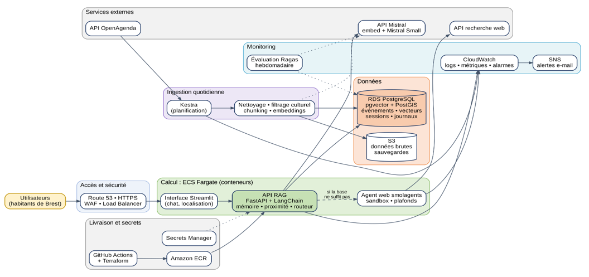
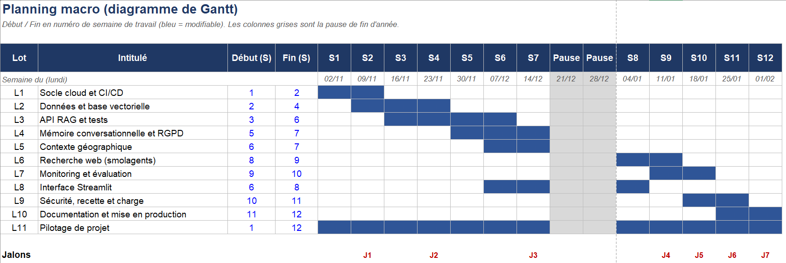

# Du POC au MVP : étude de conception et gestion de projet (Puls-Events)

Ce dépôt contient le travail de gestion de projet que j'ai réalisé pour faire passer un chatbot IA du stade de **POC** (une démo qui prouve que l'idée marche) au stade de **MVP** (une première version utilisable par de vrais utilisateurs, hébergée dans le cloud).

Important : ici, **rien n'est codé**. C'est une **étude de conception** : on planifie, on chiffre, on anticipe les risques et on dessine l'architecture avant de construire. C'est exactement ce que demandait la mission.

---

## Le contexte en deux mots

Lors d'un projet précédent, j'ai construit un **POC** : un assistant qui recommande des événements à Brest à partir des données d'OpenAgenda, sans inventer de réponses (architecture RAG).

Le POC a plu. Mon responsable technique, m'a donc demandé de préparer la suite : un MVP solide, capable de monter en charge.

## Ce qui était demandé :  

Quatre évolutions à intégrer dans la conception :

| Évolution | En clair |
|---|---|
| **Mémoire conversationnelle** | L'assistant se souvient des derniers échanges (« et c'est gratuit ? ») |
| **Contexte géographique** | Il propose des événements proches de l'utilisateur |
| **Recherche web en temps réel** | Il va chercher une info récente sur le web avec smolagents (Hugging Face) quand sa base ne suffit pas |
| **Monitoring** | On sait si le service est fiable, à jour et abordable |

Et un rapport de gestion de projet qui couvre : besoins, plan de projet, backlog, architecture cloud, coûts (construction et exploitation), bilan.

## Ce que contient ce dépôt

| Fichier | À quoi il sert |
|---|---|
| `docs/rapport_gestion_projet.pdf` | **Le rapport complet** (suit le template fourni). C'est le document principal. |
| `docs/support_presentation.pptx` | Le support utilisé pour la soutenance orale |
| `docs/backlog_couts_planning.xlsx` | Le classeur Excel : backlog, risques, jalons, planning, coûts, hypothèses (modifiable, tout se recalcule) |
| `docs/schema_architecture_MVP.png` | Le schéma de l'architecture cloud |
| `docs/gantt_planning_MVP.png` | Le planning en diagramme de Gantt |

---

## L'étude en résumé

### 1. Les besoins et les utilisateurs
Quatre profils : l'habitant de Brest qui cherche une sortie rapide, la famille, le visiteur qui ne connaît pas la ville, et l'équipe Puls-Events qui suit la qualité et les coûts. Pour chacun, des exemples de questions concrètes (« une expo à moins de 2 km de Recouvrance », « et c'est gratuit ? », « le concert de ce soir est-il maintenu ? »).

### 2. Le plan de projet
- **12 semaines de travail**, du 2 novembre 2026 au 5 février 2027, avec une pause à Noël
- **8 jalons (J0 à J7)**, chacun avec une démonstration et un critère d'acceptation :
  validation de l'étude (J0, 30 octobre), socle cloud, données et base vectorielle, API avec mémoire et géographie (J3, 18 décembre), agent web et interface, monitoring, recette, mise en production (J7, 5 février)
- Des cycles de 2 semaines et un registre de risques revu chaque semaine

### 3. Le macro backlog
**28 fonctionnalités**, classées avec une méthode MoSCoW simplifiée :
- **19 Must-Have** : indispensables au MVP, soit environ 82 jours de travail
- **9 Nice-to-Have** : utiles mais reportables (comptes utilisateurs par exemple), environ 40 jours, chiffrés à part

Chaque ligne a une priorité, une estimation en jours, un niveau d'incertitude technique et un jalon.

Petite précision qui prête à confusion : les 82 jours sont de la **charge de travail cumulée** de plusieurs personnes (Data Engineer, développeur à temps partiel, appui DevOps) qui avancent en parallèle. C'est pour ça que ça tient en 12 semaines. Sans renfort, on passerait à environ 16 semaines.

### 4. Les risques
**11 risques** suivis, chacun avec sa parade. Les quatre plus sérieux :
- **L'agent web** exécute du code et peut renvoyer une info fausse : conteneur isolé, outils limités, étapes et durée plafonnées, mention « source web », utilisé seulement en repli
- **Les données personnelles (RGPD)** : pas de compte, sessions anonymes, purge à 30 jours, consentement avant la géolocalisation
- **La qualité des données** : filtrage culturel et déduplication
- **Les ressources** : valider le renfort dès le cadrage

### 5. L'architecture cloud
Hébergement sur **AWS, région de Paris**, en conteneurs :

| Brique | Rôle |
|---|---|
| ECS Fargate | Fait tourner l'API, l'interface et l'agent web (isolé) sans gérer de serveurs |
| PostgreSQL (RDS) avec **pgvector** et **PostGIS** | Une seule base pour les vecteurs (recherche par le sens), les coordonnées (recherche par distance), les sessions et les logs |
| Kestra | Ingestion quotidienne des événements d'OpenAgenda |
| Terraform + GitHub Actions | Infrastructure décrite en code, tests et déploiement automatiques |
| Secrets Manager | Les clés ne sont jamais dans le code |
| CloudWatch + SNS + Ragas | Surveillance technique, alertes et évaluation hebdomadaire de la qualité des réponses |

Trois mots-clés de la consigne : **déploiement** (3 environnements, retour arrière automatique), **modularité** (4 services indépendants, on peut changer de modèle ou de base sans tout réécrire) et **monitoring** (technique, qualité de l'IA, fraîcheur des données, coûts).

### 6. Pourquoi AWS ?
Je me suis appuyé sur une veille : AWS pèse environ 28 % du marché cloud au deuxième trimestre 2026, devant Azure (20 %) et Google Cloud (15 %). Mais les trois savent tout faire. J'ai donc décidé sur deux critères : **l'expérience de l'équipe** (j'ai déjà déployé un projet sur AWS) et **l'écosystème** le plus large. Côté base vectorielle, j'ai comparé FAISS, PostgreSQL avec pgvector et Amazon S3 Vectors : PostgreSQL gagne parce qu'il regroupe tout au même endroit, et S3 Vectors reste une voie de sortie si le volume explose.

### 7. Les coûts

**Construction (build)** : environ **57 200 €**, soit 102 jours de travail (49 170 €), 15 % d'aléas, un peu de cloud pour les tests et des outils.

**Exploitation (OPEX)** selon le nombre d'utilisateurs :

| Scénario | Utilisateurs | Coût par mois | Coût par utilisateur |
|---|---|---|---|
| Pilote | 1 000 | environ 239 € | 0,24 € |
| Croissance | 10 000 | environ 428 € | 0,04 € |
| Échelle | 50 000 | environ 1 120 € | 0,02 € |

Le coût total monte avec la charge, mais le coût **par utilisateur baisse** : une grande partie de l'infrastructure est fixe et se partage entre plus de monde.

### 8. Les optimisations
7 leviers sur le scénario Croissance (cache des recherches web, cache des réponses, suppression d'un composant réseau facturé en continu, processeurs moins chers, machines Spot pour l'agent web, orchestrateur plus léger, base réservée). Avec un coefficient de prudence de 0,8 : **environ 428 € à 315 € par mois, soit à peu près 26 % d'économie**.

### 9. Le bilan : défis rencontrés et solutions

| Défi | Solution |
|---|---|
| Clé d'API écrite en dur dans un script | Clé régénérée, fichier `.env`, puis Secrets Manager dans le MVP |
| Résultats peu pertinents (l'en-tête d'un événement était séparé de sa description) | En-tête répété dans chaque extrait |
| Un même événement renvoyé plusieurs fois | Déduplication par identifiant |
| 73 % d'offres d'emploi dans les données | Filtrage culturel, devenu une fonctionnalité Must-Have |

### Les décisions demandées au responsable technique
1. Valider le périmètre Must-Have (agent web en repli seulement)
2. Confirmer un développeur à temps partiel et un appui DevOps
3. Valider AWS Paris avec une base PostgreSQL unique
4. M'autoriser à demander les devis (recherche web) et à affiner le chiffrage avec le simulateur AWS

---

## Par où commencer ?

1. Lire les **sections 1 et 7 (introduction et bilan)** du rapport pour comprendre le projet en 10 minutes
2. Regarder le **schéma d'architecture** et le **planning**
3. Ouvrir l'**Excel** pour voir le backlog, les risques et les calculs de coûts

---

**Auteur :** YILMAZ-AD, Data Engineer 

